# Video Công Thức — Hướng dẫn sử dụng

Dành cho người mới • Windows 10/11 • Bản public

Ảnh trong tài liệu là **giao diện mô phỏng với dữ liệu giả**, không phải kết quả quét thật. Số đỏ trên ảnh chỉ vị trí cần nhìn. Không dùng tài khoản hay key minh hoạ trong ảnh.

## Giới thiệu

Công cụ tìm video nổi bật trên các page Facebook bạn chọn.

Công cụ nghe và chép lời tiếng Việt ngay trên máy, rồi gom kết quả vào Excel.

Không cần mua key AI; bạn vẫn cần đọc lại lời thoại trước khi sử dụng.

## Cài đặt lần đầu

### 1. Tải công cụ về máy

1. Mở [kho mã công khai trên GitHub](https://github.com/phongka79d/tool_crawl_popular_public).
2. Bấm nút **Code**.
3. Bấm **Download ZIP**.
4. Mở thư mục **Downloads** trên máy.
5. Bấm chuột phải vào file ZIP vừa tải.
6. Chọn **Extract All… / Giải nén tất cả…**.
7. Chọn một thư mục dễ tìm, ví dụ `Documents\VideoCongThuc`.
8. Bấm **Extract / Giải nén**.
9. Mở thư mục đã giải nén có hai file `CAI_DAT.bat` và `CHAY_APP.bat`.

**Không chạy ngay trong file ZIP.** Bạn phải thấy các thư mục `backend`, `frontend` bên cạnh hai file trên.

### 2. Cài tự động

1. Bấm đúp `CAI_DAT.bat`.
2. Chờ cửa sổ đen tải và cài các thành phần.
3. Chờ dòng **“CÀI ĐẶT XONG. Đang mở ứng dụng...”**.
4. Chờ ứng dụng tự mở.

**Không cần tự cài Python hay gõ lệnh.** Bộ cài tự chuẩn bị Python 3.11, thành phần mở cửa sổ ứng dụng và thư viện còn thiếu. Bộ cài cũng tải bộ nghe tiếng Việt khoảng 486 MB; dùng Edge có sẵn hoặc chuẩn bị trình duyệt quét nếu cần. Cần Internet, khoảng **1 GB tải về** và dự trù **5–15 phút** lần đầu; mạng chậm có thể lâu hơn.

Trong cửa sổ đen, bạn sẽ thấy các bước **Kiểm tra Python 3.11**, **Kiểm tra Microsoft Edge WebView2**, **Tạo môi trường chạy riêng**, **Cài thư viện**, **Tải trước mô hình chép lời và trình duyệt quét**, rồi **Tạo lối tắt trên Desktop**. Các dòng tải xuống có thể bằng tiếng Anh. Đây là bình thường; đừng đóng khi nó vẫn đang tải.

Nếu hiện dòng đỏ **“LỖI: …”** hoặc mất mạng, kết nối mạng rồi chạy lại `CAI_DAT.bat`: bộ cài tiếp tục chuẩn bị các phần còn thiếu. Nếu vẫn lỗi, chụp phần báo lỗi để nhờ hỗ trợ, không gửi cookie hay key. Nếu báo đang chạy trong file ZIP, đóng cửa sổ và làm lại bước **Extract All** trước.

## Mở ứng dụng

1. Bấm đúp biểu tượng **Video Công Thức** trên Desktop (màn hình nền).
2. Chờ cửa sổ **Video Công Thức** xuất hiện như Hình 1.
3. Bấm tab **Cài đặt** ở số ① nếu đang ở tab khác.

Nếu không thấy biểu tượng Desktop, mở thư mục công cụ đã giải nén rồi bấm đúp `CHAY_APP.bat`. Giữ nguyên thư mục này sau khi cài để biểu tượng vẫn mở được ứng dụng. Cửa sổ đen chỉ hiện thoáng qua rồi tự đóng; ứng dụng vẫn chạy trong cửa sổ **Video Công Thức**.

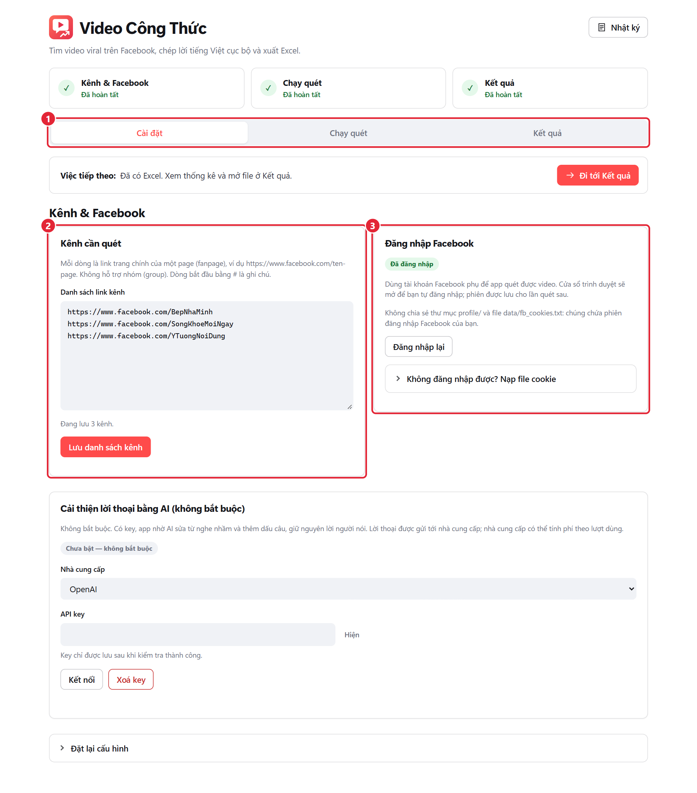

① Các tab Cài đặt, Chạy quét, Kết quả. ② Nơi nhập kênh. ③ Nơi đăng nhập Facebook. Ảnh mẫu đã đăng nhập; lần đầu bạn sẽ thấy “Chưa đăng nhập”.

## Bước 1: Nhập kênh

1. Bấm tab **Cài đặt** ở Hình 1 số ①.
2. Bấm vào ô **Danh sách link kênh** ở Hình 2 số ①.
3. Dán link trang chính của một page Facebook vào một dòng.
4. Xuống dòng để thêm page tiếp theo nếu cần.
5. Bấm **Lưu danh sách kênh** ở Hình 2 số ②.
6. Kiểm tra dòng **“Đang lưu … kênh”** phía dưới ô nhập.

Ví dụ một dòng: `https://www.facebook.com/ten-page`. Thay `ten-page` bằng tên page thật bạn muốn xem. Không dán link nhóm, link một bài viết hoặc một Reel riêng lẻ. Lần thử đầu nên dùng **1 kênh** để dễ theo dõi. Nếu báo dòng không hợp lệ, sửa đúng dòng được chỉ ra rồi lưu lại.

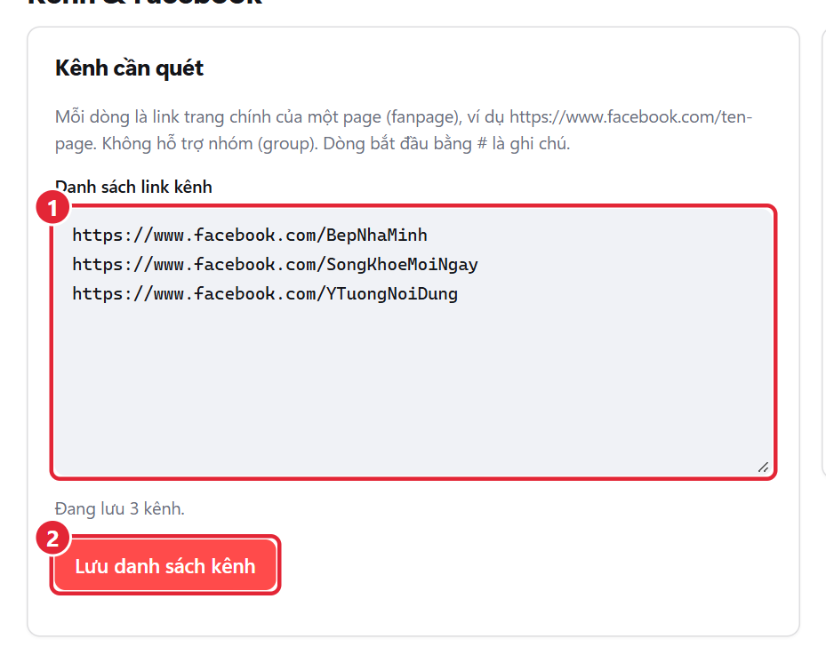

① Mỗi dòng một link page. ② Nút lưu danh sách.

## Bước 2: Đăng nhập Facebook

1. Bấm **Đăng nhập Facebook** ở Hình 3 số ①.
2. Đăng nhập bằng **tài khoản phụ** trong cửa sổ Facebook mới mở.
3. Hoàn tất xác minh do Facebook yêu cầu nếu có.
4. Chờ ứng dụng hiện **“Đã đăng nhập”**.

Nếu ứng dụng đã ghi “Đã đăng nhập”, bạn không cần đăng nhập lại. Nút trong ảnh đổi thành **Đăng nhập lại** vì phiên mẫu đã sẵn sàng. Bạn tự nhập mật khẩu trong Facebook; không gửi mật khẩu cho người hỗ trợ.

### Nếu cửa sổ đăng nhập không dùng được

1. Đăng nhập tài khoản phụ trên trình duyệt bạn thường dùng.
2. Dùng tiện ích **Cookie-Editor** từ kho tiện ích chính thức của trình duyệt để xuất cookie của `facebook.com` ra file JSON hoặc TXT.
3. Bấm dòng **Không đăng nhập được? Nạp file cookie** ở Hình 3 số ②.
4. Bấm **Chọn file cookie…** ở Hình 3 số ③.
5. Chọn file vừa xuất trên máy.
6. Chờ trạng thái **“Đã đăng nhập”**.

**Cookie giống như chìa khoá tài khoản.** Không tải cookie lên website, không gửi qua chat và không dùng tiện ích không rõ nguồn. Nếu chưa quen thao tác này, nhờ người đáng tin hỗ trợ ngay trên máy; không cần chia sẻ file. Khi cookie hết hạn, đăng nhập hoặc xuất lại file mới.

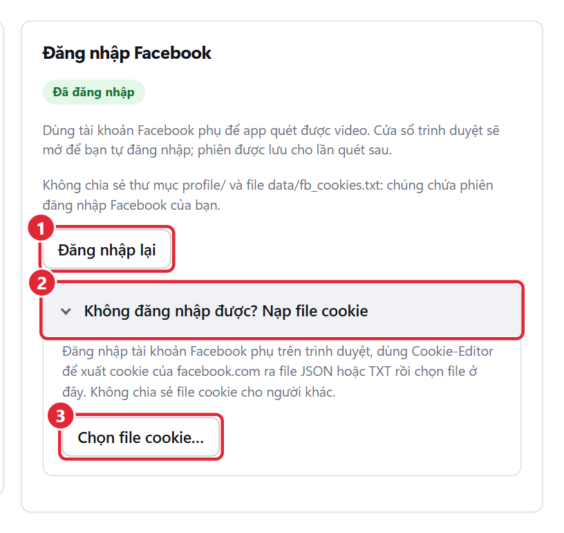

① Mở Facebook để đăng nhập. ② Mở phần nạp cookie. ③ Chọn file cookie có sẵn trên máy.

## (Tuỳ chọn) Thêm key AI để lời thoại chuẩn hơn

**Không bắt buộc và có thể tốn tiền.** Bỏ qua mục này nếu bạn chỉ muốn chạy miễn phí trên máy. AI chỉ giúp sửa từ nghe nhầm và dấu câu; vẫn có thể sửa sai. Khi bật, lời thoại được gửi cho nhà cung cấp AI.

Key là mã truy cập riêng do nhà cung cấp cấp cho bạn, không phải mật khẩu Facebook. Bạn có thể tạo key ở trang quản lý API chính thức của [OpenAI](https://platform.openai.com/api-keys), [Anthropic](https://console.anthropic.com/) hoặc [OpenRouter](https://openrouter.ai/keys). Có thể cần bật thanh toán hoặc nạp tiền; gói chat trả phí không nhất thiết bao gồm phí API. Xem giá và đặt giới hạn chi tiêu tại nhà cung cấp trước khi dùng.

1. Bấm tab **Cài đặt** ở Hình 1 số ①.
2. Cuộn đến **Cải thiện lời thoại bằng AI (không bắt buộc)** như Hình 4.
3. Chọn **Nhà cung cấp** ở Hình 4 số ①.
4. Dán key của chính bạn vào **API key** ở Hình 4 số ②.
5. Bấm **Kết nối** ở Hình 4 số ③.

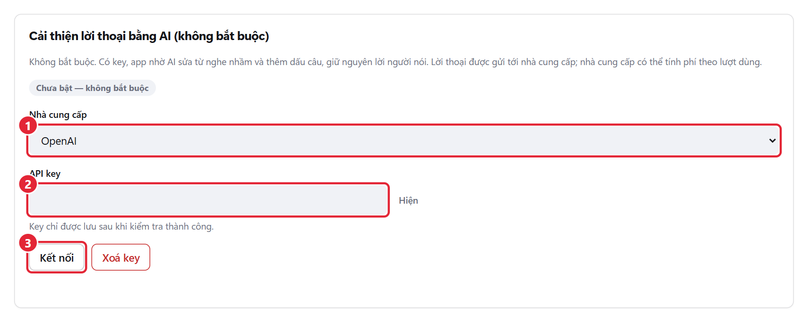

① Nhà cung cấp. ② Ô nhập key được che ký tự. ③ Kết nối để lấy danh sách model.

1. Giữ model có chữ **Đề xuất** ở Hình 5 số ① nếu không biết chọn gì.
2. Bấm **Kiểm tra và lưu** ở Hình 5 số ②.
3. Chờ thông báo đã bật AI.

Muốn tắt: bấm **Xoá key** ở Hình 5 số ③. Nếu kết nối lỗi, kiểm tra đúng nhà cung cấp, key và số dư; bạn vẫn có thể quét mà không dùng AI. Chỉ chọn endpoint tự nhập khi bạn biết rõ dịch vụ mình dùng; người mới nên chọn nhà cung cấp có sẵn.

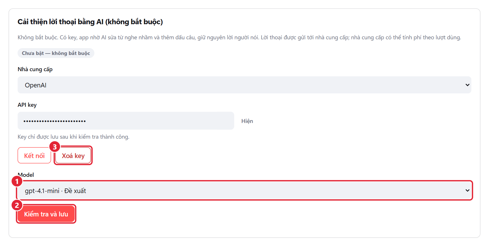

① Model. ② Kiểm tra rồi lưu key vào kho bảo mật Windows. ③ Xoá key để tắt AI. Key trong ảnh là dữ liệu giả, không sử dụng được.

## Bước 3: Chạy quét

1. Bấm tab **Chạy quét** ở Hình 1 số ①.
2. Giữ **14 ngày** ở Hình 6 số ① cho lần đầu.
3. Giữ chọn cả **Video thường** và **Reel** ở Hình 6 số ①.
4. Giữ **50.000 lượt xem**, **hệ số 3** và **10 video mỗi kênh** ở Hình 6 số ②.
5. Đọc phần lưu ý Facebook ở Hình 6 số ③.
6. Đánh dấu **Tôi đã đọc và tự chịu trách nhiệm** nếu bạn đồng ý.
7. Bấm **Bắt đầu quét** ở Hình 6 số ④.

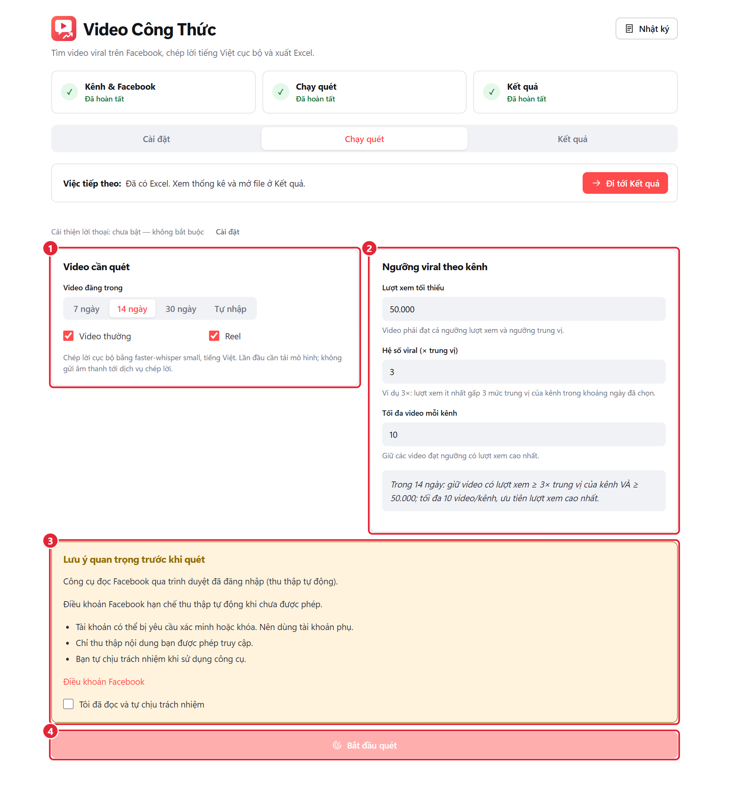

① Khoảng ngày và loại video. ② Điều kiện chọn video. ③ Lưu ý và ô xác nhận. ④ Bắt đầu quét.

| Tuỳ chọn | Hiểu đơn giản | Khuyên dùng lần đầu |
| --- | --- | --- |
| Video đăng trong | Chỉ xét bài đăng gần đây, không phải giới hạn thời gian chạy | 14 ngày |
| Video thường / Reel | Chọn nơi công cụ tìm video; bỏ một loại có thể giảm thời gian nhưng cũng bỏ sót nội dung | Cả hai; nếu chỉ cần Reel thì chỉ chọn Reel |
| Lượt xem tối thiểu | Video ít nhất phải có từng này lượt xem | 50.000 |
| Hệ số viral (× trung vị) | So với mức xem ở giữa của chính kênh đó; 3 nghĩa là cao ít nhất gấp 3 mức thông thường | 3 |
| Tối đa video mỗi kênh | Chỉ giữ tối đa số này trong các video đạt điều kiện, ưu tiên lượt xem cao nhất | 10 |

Video phải đạt **cả hai** điều kiện lượt xem. Ví dụ mức ở giữa của kênh là 20.000, hệ số 3 tạo ngưỡng 60.000; với tối thiểu 50.000 thì phải từ 60.000 trở lên. Không bảo đảm kênh nào cũng có video đạt ngưỡng.

### Trong lúc chạy

1. Nhìn hai thanh công việc ở Hình 7 số ① để biết máy đang đọc Facebook hay chép lời.
2. Nhìn từng kênh ở Hình 7 số ② để biết đã tìm và giữ được bao nhiêu video.
3. Để ứng dụng tiếp tục chạy đến khi xuất Excel.

Nếu muốn dừng, bấm **Dừng quét** ở Hình 7 số ③ rồi chờ thông báo; không tắt máy đột ngột. Sau khi dừng, xem thông báo có file kết quả hay không. Không mở nhiều lượt quét cùng lúc.

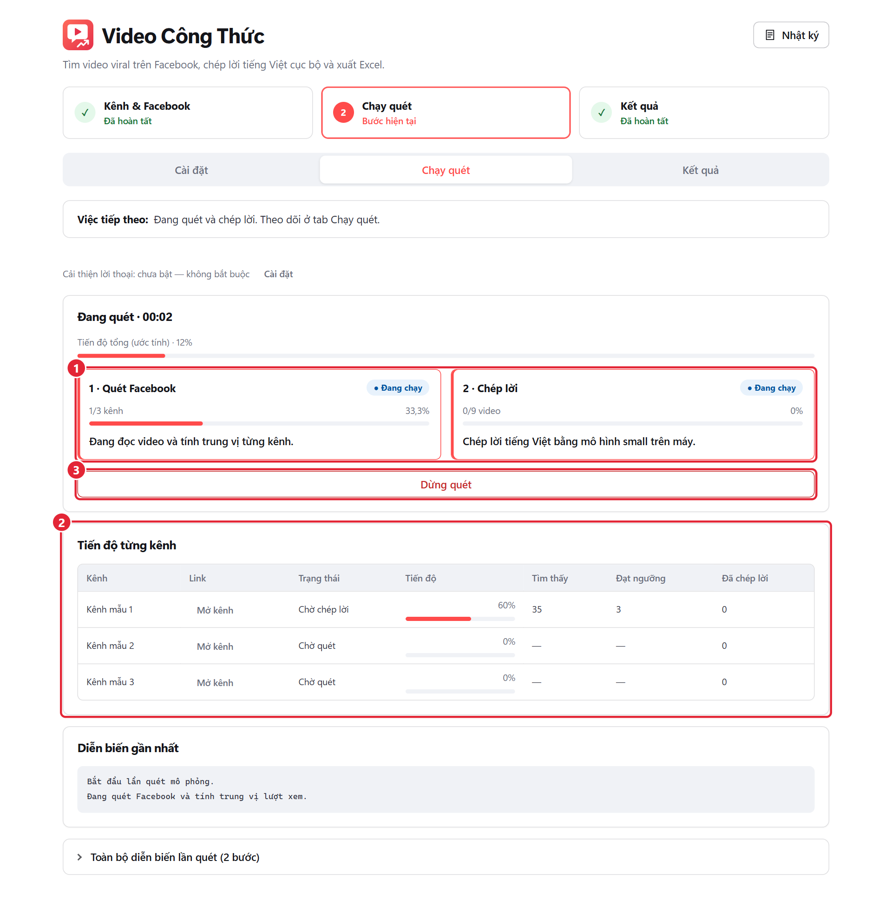

① Tiến độ quét và chép lời. ② Tình hình từng kênh. ③ Dừng khi cần.

**Nghỉ 30–60 giây giữa các kênh là cố ý**, nhằm giảm dồn yêu cầu vào Facebook, không phải lỗi treo và không bảo đảm tài khoản sẽ không bị hạn chế. Trong lúc nghỉ, máy có thể ít hoạt động. Đọc dòng diễn biến gần nhất trước khi bấm dừng.

**Mất bao lâu?** Hãy dự trù vài phút cho một kênh có vài video cần chép lời; nhiều kênh hoặc video dài có thể lâu hơn nhiều. Trong một lần đo, riêng đọc hai tab của một kênh mất khoảng hơn 1 phút; tải và chép một đoạn 40–55 giây mất thêm hàng chục giây. Tốc độ phụ thuộc máy, mạng, số bài và lần tải bộ nghe đầu tiên; đây không phải cam kết thời gian. Hình mô phỏng chạy nhanh hơn thực tế.

## Bước 4: Xem kết quả & mở Excel

### Mở file vừa xuất

1. Chờ màn hình hoàn tất như Hình 8.
2. Bấm **Mở file Excel** ở Hình 8 số ①.

File mở bằng phần mềm đọc `.xlsx` trên máy. Nếu máy chưa có Excel, có thể mở bằng LibreOffice Calc; bố cục có thể hơi khác. Không cần tải báo cáo lên dịch vụ online.

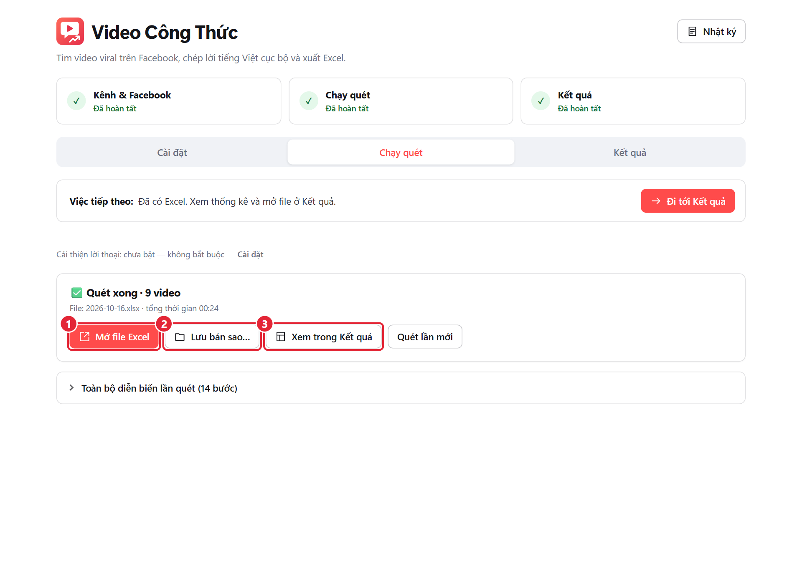

① Mở file đã xuất. ② Lưu thêm một bản ở nơi dễ tìm. ③ Chuyển sang tab Kết quả.

### Tìm lại kết quả cũ

1. Bấm **Xem trong Kết quả** ở Hình 8 số ③, hoặc tab **Kết quả** ở Hình 1 số ①.
2. Chọn file muốn xem ở Hình 9 số ①.
3. Đọc thống kê ở Hình 9 số ②.
4. Cuộn xuống danh sách file như Hình 10.
5. Bấm **Mở bằng Excel** ở Hình 10 số ①.

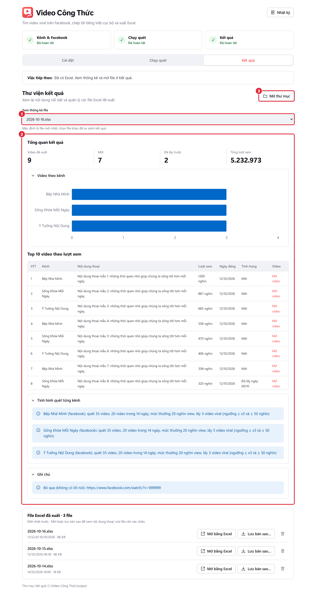

① Chọn file để đổi thống kê. ② Tổng quan. ③ Mở thư mục chứa các file.

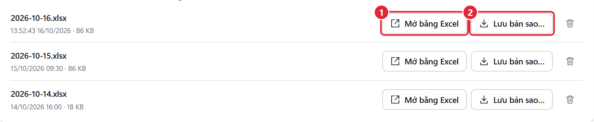

① Mở đúng file của dòng này. ② Lưu bản sao vào thư mục bạn chọn. Chọn thống kê ở Hình 9 không đổi nút mở ở các dòng khác: nhớ nhìn tên file.

File gốc nằm trong thư mục `output` của công cụ. Tên dạng `2026-10-16.xlsx`; chạy thêm cùng ngày sẽ có ` (lần 2)`, ` (lần 3)`… Muốn gửi nội dung cho người khác, hãy kiểm tra và lọc dữ liệu riêng tư trước, không gửi cả thư mục công cụ.

### Đọc ba trang trong Excel

Bấm tên trang ở cạnh dưới cửa sổ Excel để đổi trang; Hình 11 số ⑤ cho biết ba tên cần tìm. Hình này là **bản xem dựng từ file Excel do công cụ xuất với dữ liệu giả**; các cột được chia thành nhóm để dễ đọc, không phải ảnh chụp cửa sổ Excel.

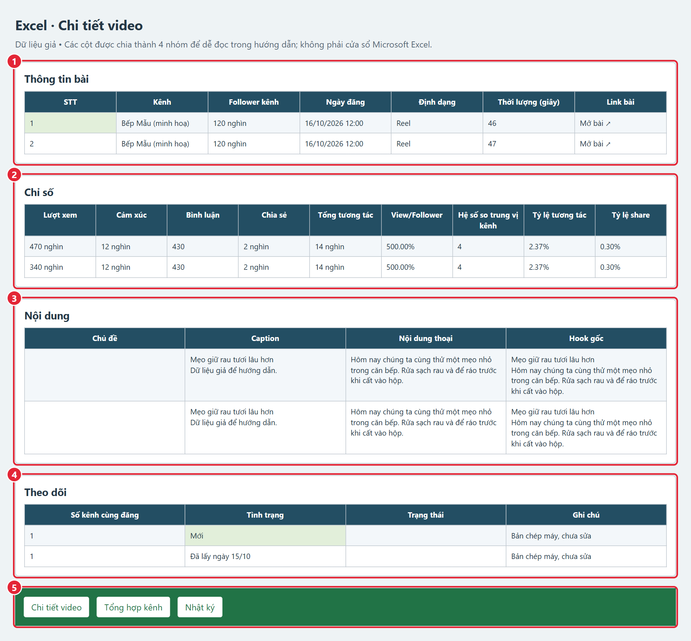

① Thông tin bài. ② Chỉ số. ③ Nội dung. ④ Theo dõi. ⑤ Ba trang của file Excel.

| Trang | Dùng để làm gì |
| --- | --- |
| Chi tiết video | Mỗi dòng là một video; có link, chỉ số và lời thoại. Đây là trang làm việc chính. |
| Tổng hợp kênh | Tổng quan lượt chạy, thống kê từng kênh, mức trung vị, ngưỡng lấy thực tế và 10 video nhiều lượt xem nhất. Không có phân tích công thức bằng AI. |
| Nhật ký | Thời gian chạy, tuỳ chọn, bộ nghe tiếng Việt, dịch vụ AI nếu bật, kết quả từng kênh, các video bỏ qua và lỗi. Dòng bỏ qua màu xám; lỗi màu đỏ. |

| Nhóm cột ở trang Chi tiết video | Cách đọc |
| --- | --- |
| Thông tin bài (①) | STT; tên kênh; follower là người theo dõi; ngày giờ đăng theo giờ Việt Nam; Video thường/Reel; thời lượng tính bằng giây; Link bài để mở video. |
| Chỉ số (②) | Lượt xem, cảm xúc, bình luận, chia sẻ; tổng tương tác là cộng các chỉ số tương tác đã biết. View/Follower so lượt xem với người theo dõi; Hệ số so trung vị kênh so với mức ở giữa; tỷ lệ tương tác và tỷ lệ share so với lượt xem. |
| Nội dung (③) | **Chủ đề để bạn tự điền**. Caption là chữ của bài đăng. Nội dung thoại là bản chép lời, ưu tiên bản AI sửa nếu bật. Hook gốc gồm dòng caption đầu và tối đa 30 từ đầu lời nói gốc, không phải câu do AI sáng tác. |
| Theo dõi (④) | Số kênh cùng đăng giúp nhận ra nội dung xuất hiện nhiều nơi. Tình trạng cho biết mới hay đã lấy. **Trạng thái để bạn tự điền**, ví dụ “Chưa đọc”, “Đã chọn”. Ghi chú báo bản chép máy/AI sửa và các lưu ý. |

**“Mới”** nghĩa là lần đầu video được lấy vào lịch sử công cụ, không nhất thiết vừa đăng hôm nay. **“Đã lấy ngày …”** nghĩa là đã lấy trước đó: lời thoại được dùng lại, chỉ số cập nhật theo lần quét hiện tại. Video mới nằm trước và có ô đánh dấu xanh nhạt; trong từng nhóm, video nhiều lượt xem hơn đứng trước.

Các số như **“6,6 triệu”**, **“66 nghìn”** là cách viết ngắn để dễ đọc. Ô trống ở chỉ số nghĩa là chưa biết, không nhất thiết là 0. Công cụ bỏ video không đủ lời nói và gộp kịch bản lời thoại quá giống nhau, nên số dòng cuối có thể ít hơn số video đạt ngưỡng ban đầu.

Muốn tự đánh dấu công việc: nhập vào **Chủ đề** hoặc **Trạng thái** tại Hình 11 nhóm ③/④ rồi lưu trong Excel. Đừng nhầm **Trạng thái** bạn tự ghi với **Tình trạng** do công cụ ghi. Đọc lại lời thoại, nhất là tên riêng, con số và các chữ dễ nghe nhầm.

## Xử lý sự cố thường gặp

| Vấn đề bạn thấy | Bạn nên làm |
| --- | --- |
| Cài đặt lỗi, mạng chậm hoặc báo thiếu Python | Kiểm tra Internet rồi chạy lại CAI_DAT.bat. Bộ cài tự chuẩn bị Python 3.11 và tiếp tục các phần còn thiếu. Nếu vẫn lỗi, chụp dòng báo lỗi để nhờ hỗ trợ; không cài ngẫu nhiên nhiều bản Python. |
| Windows SmartScreen hoặc file .bat bị chặn | Kiểm tra file tải đúng từ kho GitHub ở mục cài đặt. Ở màn hình “Windows protected your PC”, chỉ khi đã tin nguồn mới chọn More info → Run anyway. Không tắt Defender/SmartScreen toàn máy. Nếu file vẫn bị chặn, có thể chuột phải ZIP → Properties → Unblock nếu có, rồi giải nén lại. Máy cơ quan cần nhờ quản trị viên. |
| Cửa sổ ứng dụng trắng | Chờ một lúc ở lần đầu. Chạy lại CAI_DAT.bat để chuẩn bị thành phần cửa sổ WebView2 còn thiếu. Đóng ứng dụng, mở lại bằng biểu tượng Desktop hoặc CHAY_APP.bat; nếu vẫn trắng, giữ ảnh lỗi cửa sổ đen để nhờ hỗ trợ. |
| Facebook yêu cầu xác minh | Tự hoàn tất trong cửa sổ Facebook của mình; không gửi mã xác minh. Nếu bị hạn chế, dừng quét và làm theo Facebook, không cố né xác minh. Có thể đăng nhập lại tại Hình 3 số ① khi tài khoản dùng được. |
| Không tìm thấy video | Kiểm tra link page và trạng thái đăng nhập (Hình 2–3). Xem page có video trong khoảng ngày đã chọn không. Đọc Nhật ký. Có thể tăng từ 14 lên 30 ngày hoặc giảm ngưỡng Hình 6 số ② nếu phù hợp; ít kết quả không nhất thiết là lỗi. |
| Tải video/âm thanh thất bại | Kiểm tra mạng và mở link bài xem còn xem được không. Video bị xoá, riêng tư hoặc giới hạn có thể không tải được. Đọc ghi chú rồi thử lại sau; không bật nhiều lượt quét liên tiếp. |
| Lời thoại sai chữ | Máy có thể nghe nhầm, nhất là nhạc, giọng địa phương, tên riêng. Đọc và sửa trong Excel; có thể bật AI theo Hình 4–5, nhưng AI không bảo đảm đúng. Không có key vẫn dùng bình thường. |
| Có vẻ đứng im khi nghỉ giữa kênh | Xem dòng diễn biến và tiến độ ở Hình 7. Nghỉ 30–60 giây là bình thường; lần tải bộ nghe đầu tiên có thể lâu hơn. Nếu qua nhiều phút mà không có thay đổi hay tải mạng, ghi lại thông báo trước khi dừng và nhờ hỗ trợ. |
| Excel đang mở khiến không lưu được | Đóng file Excel đang mở, nhất là file bạn chọn làm nơi lưu bản sao. Thử lưu bản sao với tên mới hoặc thư mục khác ở Hình 8 số ② / Hình 10 số ②; kiểm tra ổ đĩa còn chỗ và bạn có quyền ghi. Không xoá báo cáo cũ để thử. |

Khi cần nhờ hỗ trợ, gửi nội dung báo lỗi và bước vừa làm. Che thông tin cá nhân, link riêng, key và cookie trước khi chụp ảnh. Không gửi cả `data/` hay `profile/`.

## Bảo mật & lưu ý

- **Không chia sẻ `profile/` hoặc `data/`.** Chúng có phiên đăng nhập Facebook, cookie và dữ liệu lịch sử. Người có cookie có thể truy cập tài khoản của bạn.
- Không chia sẻ file cookie, mật khẩu, mã xác minh hoặc key AI. Chỉ nhập chúng vào đúng nơi mình tin tưởng.
- Key AI được lưu trong Windows Credential Manager, không cần dán vào file cấu hình. Nếu kho bảo mật không dùng được, công cụ từ chối lưu key; bạn vẫn chép lời trên máy được.
- Khi không dùng AI nữa, bấm **Xoá key** như Hình 5 số ③. Nếu lỡ lộ key, thu hồi key ở nhà cung cấp; chỉ xoá trong ứng dụng chưa vô hiệu hoá key đã lộ.
- File trong `output/` có thể chứa nội dung và đường dẫn không nên công khai. Kiểm tra trước khi gửi đi.
- Đọc [Điều khoản Facebook](https://www.facebook.com/terms). Facebook hạn chế thu thập tự động khi chưa được phép; tài khoản có thể bị xác minh hoặc khoá. Khoảng nghỉ không loại bỏ rủi ro này.
- Chỉ lấy nội dung bạn có quyền truy cập và được phép sử dụng. Tôn trọng quyền riêng tư, bản quyền và quy định liên quan; công cụ không cấp quyền đăng lại nội dung.
